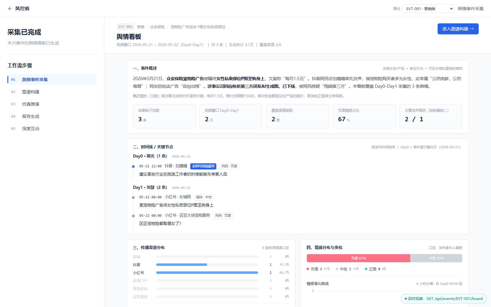
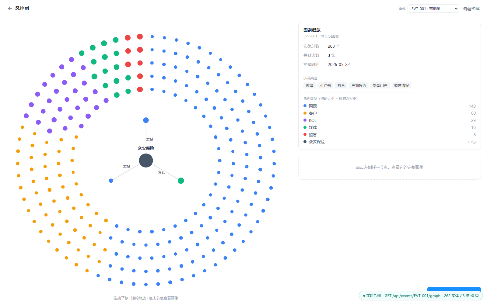
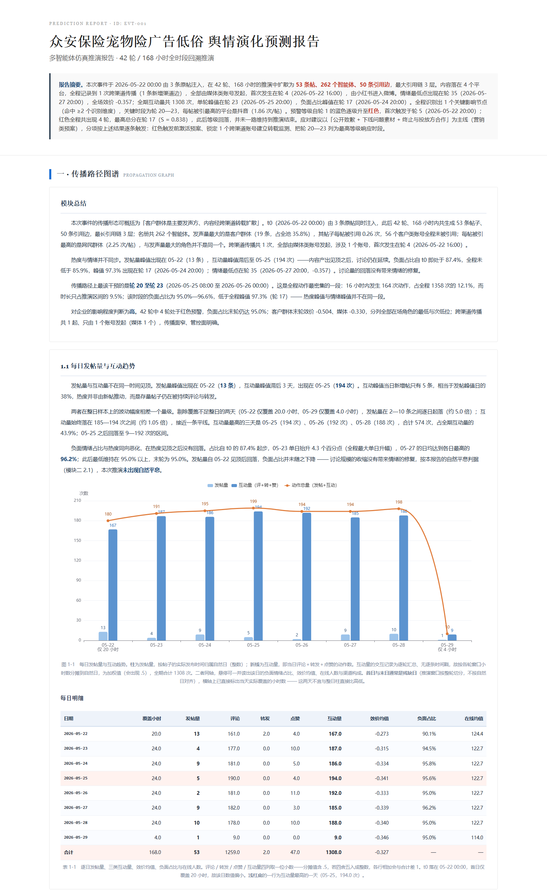
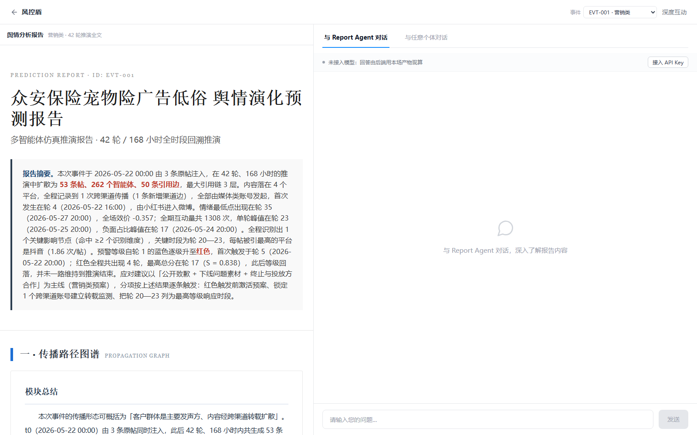
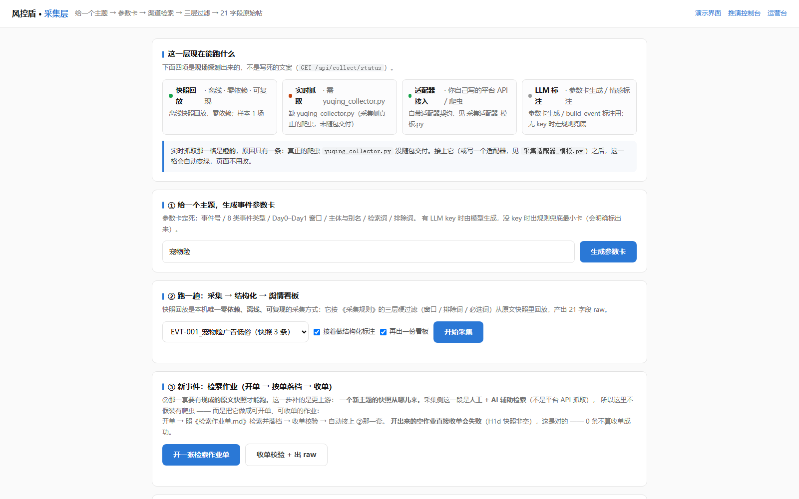

<div align="center">

# 风控盾 · 多智能体仿真舆情监测系统

**从一条原始舆情线索，到一份可执行的处置预案**

采集 → 知识图谱 → 多智能体仿真推演 → 可视化研判报告 → 在线交互


</div>

---

## 这是什么

面向保险行业的**舆情推演系统**。

传统舆情工具的产出是「过去 24 小时发生了什么」。本系统要回答的是另外三个问题：

1. **接下来会往哪儿走** —— 用一个几百人的多智能体社会，把事件在 6 个渠道之间推演 7 天，看情绪与行为的演化路径；
2. **哪里最危险、什么时候最危险** —— 从推演出的轮级状态里识别关键影响节点、关键时段与最危险的平台；
3. **谁在什么时候做什么** —— 把结论落成带主体、时点、动作、验收口径的处置建议，而不是一句「建议加强监测」。

命题要求：≥500 智能体（能力上限口径）、≥30 轮推演、推演方向与实际走向一致率 ≥70%。
实测：**42 轮 / 168 小时**，12 场真实事件回测，**方向一致率 83%**。

> 本项目为学科竞赛命题作品（命题 6），已获全国决赛一等奖。
> 本仓库为**代码与界面展示版**：不含任何事件数据。具体事件的效果由随包的前端成品演示。

---

## 目录

- [这是什么](#这是什么)
- [一眼看懂](#一眼看懂)
- [系统结构](#系统结构)
- [快速运行](#快速运行)
- [五个核心设计](#五个核心设计)
- [研判报告：五个模块](#研判报告五个模块)
- [界面「一段一段亮」](#界面一段一段亮)
- [HTTP 接口](#http-接口)
- [接入自己的模型](#接入自己的模型)
- [目录结构](#目录结构)
- [边界与说明](#边界与说明)
- [关于本项目](#关于本项目)

---

## 一眼看懂

<table>
<tr>
<td width="50%"><br><sub><b>① 舆情看板</b> —— 事件概述、时间线、渠道分布、情绪变化</sub></td>
<td width="50%"><br><sub><b>② 知识图谱</b> —— 263 个实体按角色分层成环，中心是涉事主体</sub></td>
</tr>
<tr>
<td width="50%"><br><sub><b>③ 研判报告</b> —— 五大模块的可视化报告，逐条结论可溯源</sub></td>
<td width="50%"><br><sub><b>④ 深度互动</b> —— 与整体态势或任意一个智能体对话追问</sub></td>
</tr>
</table>



<sub><b>⑤ 采集控制台</b> —— 主题 → 参数卡 → 跑采集 → 结构化 → 看板，全流程真调后端</sub>

---

## 系统结构

```
┌──────────────────────────────────────────────────────────────────┐
│  前端（零构建静态页 · 零外链 · 可内网离线）                        │
│  看板  │  知识图谱  │  推演回放  │  研判报告  │  深度互动          │
└───────────────────────────┬──────────────────────────────────────┘
                            │  HTTP（同源托管）
┌───────────────────────────┴──────────────────────────────────────┐
│  后端  app.py（Python 标准库，零第三方依赖）                       │
│  事件管理 · 任务调度 · 预检硬拦 · 进度落盘 · 产物直出              │
└───────────────────────────┬──────────────────────────────────────┘
                            │  子进程（每段一道闸，不通过即硬停）
┌───────────────────────────┴──────────────────────────────────────┐
│  编排器  跑端到端_v3.py                                           │
│  ① 采集   ② 图谱   ③ 仿真   ④ 报告   ⑤ 前端数据                  │
└───────────────────────────┬──────────────────────────────────────┘
                            │
        ┌───────────────────┴────────────────────┐
        │  仿真引擎  42 轮 × 4h，逐轮落盘快照     │
        │  报告生成  读快照 → 五模块可视化报告    │
        └────────────────────────────────────────┘
```

**为什么一条链要分五段、每段一道闸**：舆情系统最容易出的问题不是「算错」，而是「数据在跨模块传递时悄悄变了形状」——角色被折叠、渠道被改名、时间被四舍五入。所以每一段结束都校验一次字段契约，对不上就停在那一段，而不是让错误一路传到报告里。

---

## 快速运行

```bash
cd 端到端
python 后端/app.py          # → http://127.0.0.1:5001
```

Python 3.10+，**不需要 pip install 任何东西**（后端只用标准库，前端是构建好的静态文件）。

| 地址 | 页面 |
|---|---|
| `http://127.0.0.1:5001/demo/` | 五步流程总览 +「真跑一场」一键全链面板 |
| `http://127.0.0.1:5001/demo/board/` | ① 舆情看板 |
| `http://127.0.0.1:5001/demo/step2/` | ② 知识图谱 |
| `http://127.0.0.1:5001/demo/step3/report.html` | ③ 研判报告（完整） |
| `http://127.0.0.1:5001/demo/step5/` | ④ 深度互动 |
| `http://127.0.0.1:5001/collect` | ⑤ 采集控制台 |
| `http://127.0.0.1:5001/sim` | 模块三：推演进度 + 报告（PRD 形态） |
| `http://127.0.0.1:5001/` | 运营台（建事件 / 配钥匙 / 开跑 / 看日志） |

仓库**不带事件数据**：起后端看到的是一个空运营台（等你喂自己的事件）。
但 `/demo/` 下的页面自带上一次完整推演的**内置数据**，打开就有数，右下角徽标会标注数字来源
—— **后端没起、没有事件都不会白屏**。

两个页面依赖事件数据，在空仓库下没有内容：`/demo/step3/`（逐轮回放）需要 42 份轮级快照，
`/collect`（采集控制台）需要一份样本包。它们要等你自己跑出一场事件后才可用。

---

## 五个核心设计

### 1. 42 轮等长时间轴，把「轮」做成最小可归因单位

7 天 = 168 小时 = **42 轮 × 4 小时**，等长切分，不按事件密度伸缩。

等长换来的是可比性：轮与轮之间、场与场之间可以直接对齐。**第 N 轮永远等于 t0 + N×4h**，因此报告里任何一句「第 20–23 轮风险最高」都能当场翻译成「2026-05-25 08:00 至 05-26 00:00」，建议才落得到具体时点。

每轮八步：承接状态并衰减 → 合成群体情绪偏离 → 定上场名额 → 按作息抽样 → 划定视野 → 模型决策动作 → 轮末情绪传染 → 落盘快照。

### 2. 情绪与行为同轮耦合、同批落盘

每个智能体持有**连续的效价与唤醒**两个实数，不预先分档。

- **群体侧**：情绪偏离决定这一轮有多少人上场（基准 9%，上下限 3%–20%）——舆情越激烈，参与规模越大；
- **个体侧**：个体情绪档位约束其可执行的动作档位——愤怒的人倾向于引用与转发，平静的人倾向于围观。

因此「群体情绪曲线」与「用户行为结构」不是两份各自统计的报表，而是**同一份状态的两个投影**，可以互证，也可以归因。

### 3. 跨渠道传播是仿真过程直接生成的结构化对象

6 个渠道（微博 / 抖音 / 小红书 / 新闻门户 / 黑猫投诉 / 监管通报）互达。

- 一次**转载** = 原帖的落地渠道集合新增一个渠道；
- 一次**跨渠道引用** = 引用森林里新增一条有向边。

于是「事件在平台之间的传播路径」在仿真层就是可画、可算的数据，而不是跑完之后从文本里事后推断。

### 4. 先定报告要什么，再定仿真层交什么

这是本项目在产品层面最关键的一次决定：**报告层不重新分析文本，只消费仿真层落盘的结构化字段**。

| 报告模块 | 仿真层必须交付的字段 |
|---|---|
| 一 · 传播路径图谱 | 每帖的 `channel` / `channels`（落地渠道集合）/ `quoted_id`（引用上游）/ `publish_time` / `_round`；轮级 `new_cross_channel_edges` |
| 二 · 情绪演化曲线 | `valence_mean` / `valence_mean_online` / `negative_ratio` / `arousal_mean`；帖子上的 `author_valence_at_post` / `author_arousal_at_post` |
| 三 · 关键影响节点 | `post_cnt` / `flow` / 每轮角色与渠道聚合 / `window`[起,止]；引用森林派生的出度·深度·介数·特征向量 |
| 四 · 风险等级 | 上述字段归一化后按 5 轮窗口合成 S |
| 五 · 应对建议 | `event_type` / `subject` ＋ 模块三、四的现算结果 |

**五类结构缺任何一类，报告都算不出来**：传播网络结构、逐轮双维情绪、轮级动作与角色构成、轮号到真实时点的映射、事件类型与涉事主体。

### 5. 事件参数化：换事件只改配置，不改代码

报告框架与事件解耦。换一场事件，只改 `报告配置.json` 与 `事件配置.json`——标题、涉事主体、事件类型、主线预案、渠道口径全部现算。

> 这套参数化是逐事件审计出来的，不是一次写成的。早期版本里写死了大量只对某一场事件成立的判断，换一场就会印出自相矛盾的句子（例如把「发帖最多的渠道」当成「最主要的跨渠道跳板」来回答）。最终 14 处「换事件即印错」的断言全部改成现算 + 分支：拿不到就换一句话，而不是印一个错数字。

---

## 研判报告：五个模块

| 模块 | 回答的问题 | 关键内容 |
|---|---|---|
| **一 · 传播路径图谱** | 事件怎么扩散出去 | 每日发帖量与互动趋势、渠道逐日分布、跨渠道传播明细、渠道触达里程碑 |
| **二 · 情绪演化曲线** | 群体情绪怎么走 | 全场效价与负面占比双轴曲线、最低点标注、按角色与渠道拆分 |
| **三 · 关键影响节点** | 为什么危险、何时最危险、哪个平台最危险 | 五维识别关键事件、连续 4 轮动作量最大的关键时段、渠道影响力排名 |
| **四 · 风险等级** | 要不要启动预案、启动哪一档 | 三维度八项观测量的归一化证据、逐轮风险分时序、四级预警首现时点 |
| **五 · 应对建议** | 谁在何时做什么、怎么验收 | 事件类型主线预案 ＋ 数据分支建议，每条落到主体 / 时点 / 动作 / 验收四要素 |

**关键节点的五维识别**（同轮命中 ≥2 维即记为节点）

| 维度 | 判据 |
|---|---|
| 互动量突变 | 当轮互动 ≥ 此前 3 轮基线的 2 倍 |
| 情绪拐点归因 | 单轮效价跌幅 ≥ 0.02 |
| 跨渠道传导 | 新渠道首现，或出现跨渠道转载 |
| 角色行为突变 | 某类角色当轮发帖 ≥3 条且达全程均值 3 倍 |
| 多点共振 | ≥3 个渠道同轮出现新帖 |

**影响倍数** = 事件后 3 轮互动均值 ÷ 事件前 3 轮均值 → 一级催化剂（≥2 倍）/ 二级放大器 / 前哨信号（<1.25 倍）。

**风险分**

```
S = 0.35 · G1 传播广度 + 0.30 · G2 情绪态势 + 0.35 · G3 参与强度
```

- G1 = 渠道加权帖量 0.60 / 发帖渠道种数 0.25 / 新增跨渠道边 0.15
- G2 = 效价强度 0.60 / 负面人数占比 0.40
- G3 = 发声人数 0.35 / 动作强度加权互动 0.35 / 新生帖介数峰值 0.30
- 六项取 5 轮滑动窗口（约 20 小时）聚合，两项取当轮即时值 —— 分数**有升有降、等级可回落**，避免预警单向上锁
- 四级阈值：红 ≥0.80 / 橙 ≥0.65 / 黄 ≥0.50 / 蓝 <0.50

规则级常量（不随单次运行变化）：渠道权重 监管通报 3.0 / 黑猫投诉 2.5 / 新闻门户 2.0 / 微博·小红书·抖音 1.5；
动作强度 通报 5 / 投诉引用 4 / 引用 4 / 转发 3 / 评论 2 / 点赞 1。

---

## 界面「一段一段亮」

长耗时推演最怕的是「点了之后什么都没有」。编排器在链路中途会**提前烘两次前端数据**：

| 时机 | 烘什么 | 界面上看到什么 |
|---|---|---|
| 采集段结束 | 看板（先落暂存区） | — |
| 图谱段结束 | 搬进事件目录 ＋ 烘图谱 | 看板有数、知识图谱可看，**仿真还没开始** |
| 仿真进行中 | 每轮写快照 | 回放页的轮次与进度条跟着真实轮次走 |
| 报告段结束 | 报告 HTML | 报告页与预警弹窗同时就绪 |

实测：看板与图谱在 **0.2 分钟**内即可见，绝大部分耗时集中在仿真与报告两段。

---

## HTTP 接口

全部返回 `{"ok": true, ...}`；出错为 `{"ok": false, "error": "..."}`。**零第三方依赖**，路由与静态服务都在标准库里实现。

**事件与任务**

| 方法 | 路径 | 说明 |
|---|---|---|
| GET | `/api/health` | 存活与版本 |
| GET | `/api/events` | 事件列表（含轮次、报告、任务状态） |
| POST | `/api/events` | 新建事件 |
| GET | `/api/events/{id}` | 单场详情 |
| POST | `/api/events/{id}/precheck` | 预检（缺字段直接拦下） |
| POST | `/api/events/{id}/llm` | 写入本场模型凭据（**不回显**） |
| POST | `/api/events/{id}/run` · `/stop` | 起跑 / 停止 |
| POST | `/api/events/{id}/report` | 触发报告生成 |
| GET | `/api/events/{id}/status` | 进度（轮次、百分比、记录员行数、任务态） |
| GET | `/api/events/{id}/report` · `/alert` | 报告 HTML / 预警数据 |

**只读产物**

| 方法 | 路径 | 说明 |
|---|---|---|
| GET | `/api/events/{id}/board` | 看板整包 |
| GET | `/api/events/{id}/graph` | 图谱整包 |
| GET | `/api/events/{id}/roster` | 智能体名册 |
| GET·POST | `/api/events/{id}/chat` | 深度互动（无密钥时自动降级为按本场产物现算的规则回答） |

**一键全链**

| 方法 | 路径 | 说明 |
|---|---|---|
| POST | `/api/events/{id}/pipeline` | 起链（可指定起止段） |
| GET | `/api/events/{id}/pipeline` | 进度（从编排器日志的段标记真读） |
| POST | `/api/events/{id}/pipeline/stop` | 停（Windows 上连子进程树一起杀） |

**采集层**

| 方法 | 路径 | 说明 |
|---|---|---|
| GET | `/api/collect/status` | 四种采集模式的真实可用性 |
| POST | `/api/collect/card` | 主题 → 参数卡 |
| POST | `/api/collect/run` | 跑一趟（采集 + 结构化 + 看板） |
| POST | `/api/collect/job/open` · `/job/collect` | 新事件开单 / 收单校验（12 项检查） |
| GET | `/api/collect/log` · `/preview` | 日志 / 产物直出（白名单） |

---

## 接入自己的模型

三种方式，任选其一，**都不用改代码**：

1. **界面填**：任意页面右上「接入 API Key」→ 填 Key / Base URL / 模型名 → 保存并测试。凭据只落本地、**界面永不回显**。
2. **环境变量**
   ```bash
   export LLM_BASE_URL=https://api.deepseek.com/v1
   export LLM_API_KEY=sk-自己的
   export LLM_MODEL_NAME=deepseek-chat
   python 后端/app.py
   ```
3. **`.env` 文件**（推荐，钥匙不进仓库）
   ```bash
   export SIM_ENV=/path/to/llm.env
   python 后端/app.py
   ```

优先级：界面 > 事件配置 > `SIM_ENV` > 进程环境变量。

**没有密钥也能跑**：深度互动会自动降级为「按本场产物现算」的规则回答，同样带真实数字，并明确标注 `source: "rules"` —— 不静默编一句话冒充模型。

---

## 目录结构

```
端到端/
├── 后端/            零依赖 stdlib 服务（app.py + 6 个模块 + 5 支自检）
│   └── 静态/        前端成品（构建产物，勿手改）
│       ├── demo/    五步流程五页 + 单文件版
│       ├── collect.html   采集控制台
│       └── sim.html/js/css 模块三实时页
├── 引擎/            仿真内核：42 轮、八步、双维情绪、跨渠道
├── 报告/            报告层：抽取 → 风险分级 → 可视化构建
├── 采集层/          采集可运行件：快照回放 / 适配器 / 检索作业开单收单
├── 前端数据/        帖子 → board.json / graph.json
├── 跑端到端_v3.py   五段编排器
└── 中间产物/图谱/   运行期产物目录（仓库中为空）
graphrag/            知识图谱建图、定槽位、选人
docs/                架构说明与截图
```

---

## 边界与说明

**这个仓库能做什么**

- 完整读到五段编排、仿真内核、报告层、采集层、前后端服务的全部代码；
- 起后端，把 `/demo/` 的看板、知识图谱、研判报告、深度互动打开看，数据是随包内置的；
- 按 `docs/` 的说明理解数据契约，喂进自己的事件重跑。

**这个仓库不包含什么**

- **任何事件数据**。事件涉及真实企业与真实公开帖文，本仓库只发布代码与前端成品；`中间产物\`、采集层的 `EVT-*` 样本包、情感评测基准一律不入库。**要看跑出来长什么样，请看随包的 demo 与 Pages**。
- **图谱侧的上游包**（画像库、槽位表、建图产物）。「采集段」与「图谱段」都需要你自备输入；demo 里那一份是构建期烘好的只读结果，不能当输入复用。
- **平台侧真抓取**。采集层给的是快照回放、适配器接口与检索作业流程三件事；接真实抓取只需实现 `fetch(card)` 一个函数。

**关于可复现性**

固定随机种子 + 逐轮快照落盘，使**结构量**（轮数 / 帖数 / 人数 / 动作构成）可复现；
模型生成的**自然语言文本**（temperature > 0）不保证逐字一致。报告中的每个数字都由快照现算，可从附录的溯源表回溯到具体字段。

---

## 关于本项目

学科竞赛命题 6「保险行业舆情监测与风险管理」参赛作品，全国决赛一等奖。

技术路线沿用 [MiroFish](https://github.com/666ghj/MiroFish)（AGPL-3.0）的群体智能仿真范式，
仿真内核、报告层、编排与前后端均为本团队自研，未包含 MiroFish 源码。

本仓库以 MIT 许可开源，仅用于作品展示与交流。

